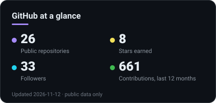
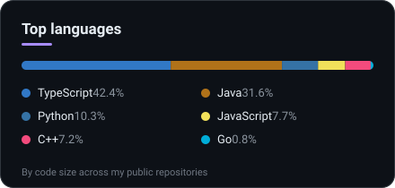

 

  

**Open to new opportunities** &nbsp;·&nbsp; 📍 Fortaleza, Brazil 🇧🇷 &nbsp;·&nbsp; 🎓 B.Sc. in Information Systems

 

## 👋 Hi, I'm Bruno

I build **mobile products people enjoy using** — and the web and back-end pieces around them.
My specialty is **React Native / Expo on iOS and Android**, but I work **full-stack**: Next.js, NestJS/Node, SQL and NoSQL, CI/CD.
I start from the **UX/UI** and work outward, with the habits of a **senior engineer**: clear architecture, tests, type safety, and ownership from the first commit to the store release and what happens after.

## ⚡ Recruiter TL;DR

| | |
|---|---|
| **What I am** | Mobile-focused full-stack engineer (React Native · Expo · TypeScript) |
| **Where I'm strongest** | Cross-platform apps in production: iOS + Android, store releases, over-the-air updates, push, deep links, social sign-in |
| **What I also do** | Web apps and APIs end to end: Next.js, NestJS, Prisma, PostgreSQL, MongoDB, MySQL, Docker |
| **How I work** | UX-first, accessible and fast UI · tested, typed, reviewable code · small, safe, reversible releases |
| **Fastest way to reach me** | [bruno.victo255@gmail.com](mailto:bruno.victo255@gmail.com) · [LinkedIn](https://www.linkedin.com/in/bruno-sales-3a5856202/) |

## 🧭 What I bring

<table>
<tr>
<td width="50%" valign="top">

### 📱 Mobile — my specialty
- **React Native + Expo** (Expo Router, Reanimated, NativeWind) in TypeScript
- **Store-ready delivery** on iOS and Android: signed builds, EAS pipelines, OTA updates
- **Native-feeling features**: push notifications, deep/universal links, Sign in with Apple and Google, maps
- **Production care**: crash reporting (Sentry), Firebase, resilient data fetching, navigation and startup performance
- **Multi-brand apps**: one codebase shipped as many white-label apps

</td>
<td width="50%" valign="top">

### 🌐 Full-stack — when the product needs it
- **Web**: Next.js, React Query, tRPC, Zustand, Tailwind
- **APIs**: NestJS / Node, JWT auth, Prisma, PostgreSQL, MongoDB, MySQL, Docker
- **REST and GraphQL**, including migrations between them behind feature flags, without breaking released app versions
- **Delivery**: CI/CD, environments, observability

</td>
</tr>
<tr>
<td width="50%" valign="top">

### 🎨 UX / UI first
- Figma to **pixel-accurate** screens, shared tokens and components
- **Accessibility**, safe areas, keyboard and gesture details that make an app feel finished
- Loading, empty and error states designed on purpose, tested on real devices

</td>
<td width="50%" valign="top">

### 🏗️ Senior engineering habits
- **Architecture for change**: clear boundaries, MVVM / composite patterns, multi-tenant design
- **Quality gates**: Jest, Testing Library, Cypress, ESLint, Husky + lint-staged
- **Ownership**: ticket → code review → release → monitoring

</td>
</tr>
</table>

## 🧰 Tech I use

**Mobile**  

**Web and back end**  

**Data and cloud**  

**Quality, delivery and design**  

## 📌 Featured work

> Public repositories. Most of my professional work lives in private codebases, so ask me about it.

| Project | What it is | Stack |
|---|---|---|
| [**meeting-assistant**](https://github.com/brunossaless/meeting-assistant) | 100% local meeting assistant: captures system audio and mic, transcribes, and summarizes with a local LLM | Python · whisper.cpp · Ollama |
| [**habitflow**](https://github.com/brunossaless/habitflow) | Contract-oriented multi-agent system for habit tracking with AI coaching | Python · multi-agent |
| [**alexa-ai-backend**](https://github.com/brunossaless/alexa-ai-backend) | Backend for an Alexa personal-agent skill, deployable with Docker | NestJS · OpenAI · Docker |
| [**tiktok-full-stack**](https://github.com/brunossaless/tiktok-full-stack) | Dashboard to view and manage TikTok Ads campaigns through the official Ads API | Next.js · tRPC · React Query · Tailwind |
| [**market-place-app**](https://github.com/brunossaless/market-place-app) | Marketplace mobile app with auth flow, typed forms and MVVM structure | Expo Router · NativeWind · React Query · Zustand |
| [**signature-app**](https://github.com/brunossaless/signature-app) + [**signature-nest-api**](https://github.com/brunossaless/signature-nest-api) | Easy document signatures: mobile app and its API | Expo · NativeWind · NestJS |
| [**praja-api**](https://github.com/brunossaless/praja-api) | REST API with JWT auth, Prisma migrations and Docker | NestJS · Prisma · Docker |
| [**portfolio**](https://github.com/brunossaless/portfolio) | My portfolio site, built with a composite-pattern component design | Next 14 · React 18 · Tailwind · Jest · Husky |
| [**gobooks-project**](https://github.com/brunossaless/gobooks-project) | Small API written to learn Go | Go |

## 📊 GitHub

## 🤝 Let's talk

If you are building a mobile product — or a product that needs mobile **and** web done well — I'd like to hear about it.

<b>🇧🇷 Resumo em português</b>

 

Sou **desenvolvedor mobile e full-stack** (Fortaleza, CE). Minha especialidade é **React Native / Expo para iOS e Android**, mas atuo de ponta a ponta: **Next.js, NestJS/Node, bancos SQL e NoSQL, Docker e CI/CD**.

Penso o produto a partir de **UX/UI** e trabalho com a postura de um **engenheiro sênior de software**: arquitetura clara, testes, tipagem forte e responsabilidade da primeira linha de código até a publicação nas lojas e o acompanhamento depois.

- **Mobile**: apps em produção na App Store e no Google Play, builds assinados, atualizações OTA, push, deep links, login social, apps white-label a partir de um único código.
- **Web e APIs**: Next.js, React Query, tRPC, NestJS, Prisma, PostgreSQL, MongoDB, MySQL; REST e GraphQL, com migrações seguras por feature flag.
- **Qualidade**: Jest, Testing Library, Cypress, ESLint, Husky, code review.

📩 **Contato:** [bruno.victo255@gmail.com](mailto:bruno.victo255@gmail.com) · [LinkedIn](https://www.linkedin.com/in/bruno-sales-3a5856202/)

